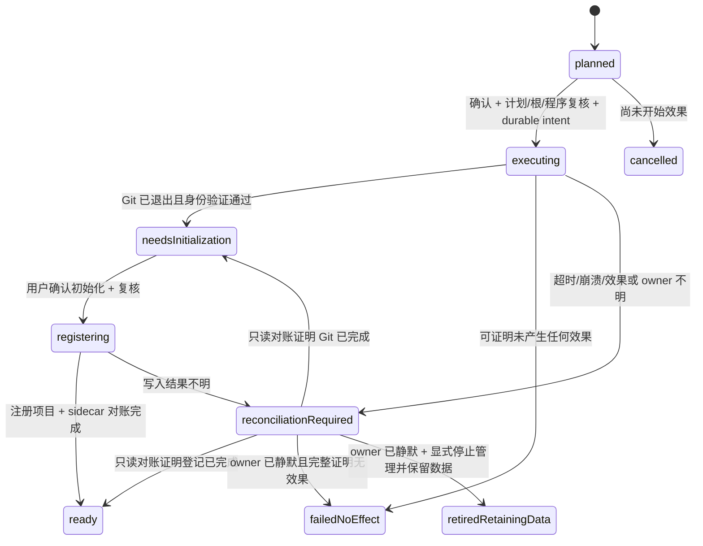

# Git 审阅与工作副本设计

日期：2026-10-23（2026-10-24 按对抗审查修订：唯一化执行顺序、内存 diff 优先、快照新鲜度/存活期分离、终态归档、损坏 resolution 分级、G01 降级阶梯）。状态：设计提案，接口、文件和行为均待实现。属于 [工作区演进设计](2026-10-23-workspace-evolution.md) 的 W6/W7；交付依赖和验收见 [实施分解](2026-10-23-delivery-acceptance.md)。

## 1. 首版交付边界

| 能力 | 首版行为 | 明确限制 |
| --- | --- | --- |
| 项目变更 | 查看已跟踪文件的 base/index/工作文件比较 | 原始字节语义，不执行仓库过滤器；不等同 Git 经过 attributes 转换的完整 status |
| 暂存比较 | index 与冻结 HEAD；支持选择完整 commit OID | 不接受 revision expression、远端名或前端任意路径 |
| 工作文件比较 | 从受保护文件句柄读取内容，与 index blob 比较 | 不递归读取未跟踪目录，不跟随 symlink，不自动预览 HTML/图片 |
| 接入工作副本 | 用户选择已有 worktree，确认所属仓库后登记 | 不修改该 worktree 的文件、分支或 Git 锁 |
| 准备工作副本 | 明确确认后创建新分支与 `--no-checkout --lock` worktree | 初始状态为“待初始化”；不自动 checkout、不启动 CLI |
| 完成准备 | 用户自行初始化，Desk 重新核对后登记为项目 | 不能用“文件夹存在”证明准备成功 |
| 解除关联 | 从 Desk 工作副本列表解除关系 | 保留原注册项目、文件、分支和 Git worktree 元数据 |

commit、stage、reset、merge、自动 checkout、remove/prune、删除分支和远程 fetch/push 不属于首版。手动初始化是首版的保守选择而非永久立场：若 G01 证明在冻结环境（清空 config、私有 HOME、禁用 hooks/filter）下执行受控 checkout 不会执行仓库内容影响的程序，后续版本可提供用户显式 opt-in 的"一键准备"；该扩展须独立设计并重走验收，不因竞品都有自动 checkout 而跳过。若只读原始比较对用户无价值，W6 用户验证可以得出停止 W7 的结论，不为凑功能引入写入。

选择此范围的理由：Git attributes 的 clean/smudge/process 可执行外部程序；禁止 external diff/textconv 并不能代替过滤器策略。`worktree add --no-checkout` 不填充工作文件，`--lock` 可在创建时锁定；工作副本仍共享仓库的部分 refs 和配置。依据：[gitattributes](https://git-scm.com/docs/gitattributes)、[git-worktree](https://git-scm.com/docs/git-worktree)、[githooks](https://git-scm.com/docs/githooks)。

## 2. 模块和 authority

新增后端目录 `src-tauri/src/workspace_git/`，由 `mod.rs` 组合 `commands.rs`、`scope.rs`、`process.rs`、`snapshot.rs`、`diff.rs`、`workspaces.rs`、`journal.rs`。不改 CLI profile 类型来承载 Git，不把 Git 填进 `NativeCliKind`。

前端新增 `src/api/workspaceGit.ts`、`src/types/workspaceGit.ts`、`src/stores/workspaceGit.ts` 和 `src/components/projects/ProjectChangesPanel.vue`、`WorkspaceCopiesPanel.vue`。authenticated wrapper 仍经 `src/api/tauri.ts` 的私有 document bridge；具体 DTO 用显式联合类型，不增加任意 method/argv 的 RPC。

`GitScope` 仅保存在后端：`actualDocumentEpoch + registeredProjectId/sourcePathKey + heldRootIdentity + gitAdminIdentity/commonDirIdentity + programBinding + policyRevision`。每次调用先验证真实 document，再查 scope 和当前项目授权。opaque scope ID、frontend owner 字段、项目路径都不是替代凭证。

普通仓库只接纳已注册项目根内的 `.git`。linked worktree 必须通过已准入的 common directory 的 worktree inventory、gitdir/commondir/backlink 和用户本次选择共同确认。不能把任意 `.git` 文件中的外部路径当作授权扩展；bare repo、submodule 工作树首版不接入。

每个平台的根绑定都需证明：读取过程中根目录替换、组件 symlink/junction、Git admin 路径重定向不能把读取扩散到范围外。复用项目现有 source identity/安全打开原语；Windows 保持必要目录句柄，POSIX 使用目录句柄相对打开。**向 Git 子进程传一个已 canonicalize 的字符串不是这个证明。** G01 必须验证 Git 实际读取 admin/object 时的路径行为；无法证明的平台或仓库布局返回 `GIT_LAYOUT_UNSUPPORTED`，该平台增强功能保持关闭，不退回普通字符串路径执行。

首版不宣称对拥有同一操作系统账户权限的恶意进程构成沙箱。即便如此，也必须防御仓库内容中可构造的路径/配置攻击，以及普通并发编辑与移动。可发布布局由 G01 的负面 fixture 确定并进入构建策略；这是一项显式技术准入，不是由实施者放宽的授权例外。

scope 在 document 撤销、项目身份/可用性改变、程序绑定改变时撤销。切项目时 UI 主动 close，迟到响应按 selectionSequence 丢弃；后端 close 不抹掉尚未 reap 的 helper owner。已捕获内容随 scope 关闭释放。

## 3. Git 程序和子进程策略

### 3.1 程序选择

用户从原生文件选择器确认本机 Git executable；设置中显示安全 basename、版本和“需重新确认”状态。Windows 首版不接受 `.cmd/.bat` 或隐式 shell 包装。程序路径及身份只保存于 Desk 私有 `git-tool.v1.json`；不能把 CLI 的程序信任当成 Git 信任。更换程序撤销全部旧 scope 和未执行计划。

版本探测也必须显式、固定参数、有 owner 和时间/输出上限。G01 针对受支持 Git 版本验证所需开关；不支持则说明最低已验证版本，不下载程序，不删减防护参数重试。

### 3.2 执行约束

- 使用 typed operation 构建独立 argv 元素；不经过 shell，不接受用户提供的 flag、env、command string 或 Git alias。OID 只接受仓库声明对象格式对应的完整十六进制值，且校验实际 object type。
- 清空继承环境，只放执行平台所需的固定 OS 变量和 Desk 拥有的临时目录；不继承 Git、SSH、代理、认证或凭据环境。清空 `GIT_CONFIG_COUNT` 等注入入口；使用空 global/system config 和私有 HOME/XDG 配置目录。
- 固定 `--no-pager --no-optional-locks --no-replace-objects --no-lazy-fetch --literal-pathspecs`。同时关闭 fsmonitor、auto maintenance/gc，hooksPath 指向 Desk 拥有的空目录，`protocol.allow=never`。不设置 `safe.directory=*`。
- 只读路径仅允许 raw plumbing：安全复制 index 后 `ls-files --stage -z`、冻结 OID 的 `ls-tree -rz`、按 OID 的 `cat-file`。批量读取必须用 `cat-file --batch`/`--batch-check` 单进程完成全部 OID，禁止逐 OID 启动进程——后者在 Windows 上无法满足任何延迟预算。不使用 `--filters`、`--textconv`，不在原仓库运行 working-tree diff/status。
- diff 首选纯内存 diff 库（Rust crate，如 `similar`/`imara-diff`）直接比较两份已捕获字节：无临时文件、无 diff 子进程、无 diff 程序/驱动策略攻击面，且与 raw-bytes 语义一致；引入前按项目流程单独评估依赖与许可证。若 G01 证明内存库路线不可用而回退外部 Git，仅允许 `git diff --no-index --no-ext-diff --no-textconv --no-renames --no-color` 在私有、非仓库临时目录执行——注意 `--no-index` 不是 plumbing，且该模式仍会读取 attributes 来源，须依赖空 global/system config 与私有 HOME/XDG 将其清空；先判定 binary，binary 内容不进入 diff/UI。解析器忽略临时路径 header，重新构造授权相对路径。退出码 0/1 分别表示无差异/有差异，其他为失败。
- 不把普通 stdout/stderr 当作安全错误正文。只返回固定码、已校验 DTO 和内部关联 ID；不输出原始 config、argv、env、绝对路径或异常载荷。

上述开关的作用见 [Git 全局选项](https://git-scm.com/docs/git)，plumbing 语义见 [ls-files](https://git-scm.com/docs/git-ls-files)、[cat-file](https://git-scm.com/docs/git-cat-file)、[diff](https://git-scm.com/docs/git-diff)。这是本方案的组合策略，仍需 G01 用实际 Git 版本验证，不是 Git 官方对该应用提供的安全保证。

仓库 local config 的 include/路径重定向、对象 alternates、对象目录 symlink、split index、sparse index、缺失 promisor 对象必须被显式拒绝或在 G01 形成可验证的支持实现。首版默认拒绝这些布局；缺对象不联网补齐。不能仅通过设置 hooksPath 就声称所有 config 已安全。

### 3.3 owner 与 maintenance

在现有 AdmissionGate（[maintenance.rs](../../src-tauri/src/version_history/maintenance.rs)）增加内部 `RuntimeKind::Auxiliary`，Git/probe helper 取得同一个 `begin_start` admission；所有匹配分支和门禁测试一起更新。它不创建 Native CLI run，也不拥有终端输入。

票据从准备、spawn 到真实退出/reap 全程随 owner 移动；timeout 后发送停止并等待，未知状态继续阻止维护准入。Git 写操作和 sidecar 的权威写入另持有原 `MutationTicket`，不能以 HTTP/IPC 返回、UI 卸载或 registry 删除视为完成。恢复中的未知 helper 必须在维护入口开放前重建阻塞状态。

首版真实 helper 不脱离监管：Windows 使用经现有政策准入的 Job；Unix 使用受监管进程组与父进程退出检测。无法取得所需监管时返回 unavailable，不通过忽略 Job 失败继续运行。崩溃后不能仅凭旧 PID kill 或断定已退出；PID 重用必须进入 reconciliation。

## 4. 只读快照和 diff

### 4.1 捕获协议

1. 取得 scope、每仓库读执行槽和 owner，冻结 program/policy/root/admin 身份。
2. 安全读取 HEAD/ref 得到完整 commit OID，或者记录 unborn。复制 index 到私有目录，单份上限 8 MiB，保存 digest；不更新原 index，也不修改其锁。admin 配置/引用单文件上限 1 MiB，枚举受 10,000 项预算限制，无法完整解析即拒绝该次读取。
3. 从冻结 index 枚举 stage 0/1/2/3；从冻结 base 枚举 tree。联合路径集合仅包含 tracked paths。按 OID 读取原始 blob。
4. 工作文件通过 scope 的安全文件打开器读取；按文件保存捕获字节、digest、长度、文件身份与观察时间。不跟随 symlink，目录碰到 gitlink 不递归。
5. 再核对 root/admin、HEAD 和完整 index digest。发生变化则整个结果标为 stale，不发布为最新快照。文件读取期间发生可检测变化，该文件标记 `changed-during-read`，保留其他条目和 partial 状态。
6. 发布不可变 snapshot；后续分页和 diff 只使用该 snapshot 的已捕获内容，不偷偷补读新文件。刷新创建新 snapshot，再成功替换旧视图。

Git 没有为外部同时改写的所有工作文件提供全仓库读事务。这里是**冻结 base/index、工作文件有界时间窗口捕获**，不是全仓库瞬时一致快照。UI 展示读取时间和“期间有文件变化”，不宣称一致提交视图；单个 diff 对应捕获到的两份确切字节。mtime/size 只用于发现变化，不作为字节相等证明。

### 4.2 数据模型

```ts
type GitComparison = 'index-base' | 'worktree-index'
type FileAvailability = 'ready' | 'binary' | 'too-large' | 'unsafe-path'
  | 'changed-during-read' | 'object-unavailable' | 'conflict'
interface GitSnapshotView {
  snapshotId: string
  baseOid: string | null
  indexDigest: string
  observedFrom: string
  observedTo: string
  consistency: 'captured-window'
  complete: boolean
  omittedCount: number | null
  limitations: string[] // 固定枚举，如 tracked-only、raw-bytes
}
interface GitFileView {
  fileToken: string
  relativePathDisplay: string
  comparison: GitComparison
  change: 'added' | 'modified' | 'deleted' | 'mode' | 'conflict'
  availability: FileAvailability
  beforeBytes: number | null
  afterBytes: number | null
}
```

fileToken 绑定 scope/snapshot/comparison/实际 path bytes，不以展示路径反查。路径中的换行、控制字符和不可解码字节用可辨认的转义展示；两个显示相同的名字也不能碰撞 token。只在明确打开项目变更时展示项目内容；内容不进遥测、通知或诊断导出。使用 Vue 文本节点，不解释 HTML/ANSI/Markdown。

rename 首版显示删除＋新增；不运行相似度推断。symlink 只显示链接自身变化，gitlink 只显示 OID；冲突展示 stage 的安全摘要，首版不做三方合并器。无提交仓库的 base 是逻辑空树，不向原 object store 写 empty-tree object。CRLF、ident、LFS pointer 等可与 Git 常规 diff 不同，显示“原始内容比较”；可选的换行显示归一化不改变状态、计数或保存内容。

### 4.3 预算和 API

以下为首版保护上限，不是当前性能实测值。每 document 最多 4 个 scope，全进程 snapshot 最多 8 个；单 snapshot 捕获内容 64 MiB，全局 256 MiB；单文件 2 MiB，最多 10,000 路径，页长固定 200；单 diff ≤1 MiB/20,000 行。请求 ≤8 KiB、响应 ≤2 MiB，snapshot deadline 10 秒、单 helper 5 秒。每仓库同时 1 个读操作、全局 2 个 helper；超限显示 partial/busy，不能省略后写"无变更"。

新鲜度与存活期分开：TTL 120 秒只表示"数据新鲜度"，过期后该快照不再作为最新结果显示，但正在审阅的快照可有界保留（默认 30 分钟、每 scope 1 个审阅中快照），期间分页与 diff 继续使用其冻结内容并显式标注 stale；用户主动刷新才切换到新快照，旧快照在无引用后释放。不使用"过期即拒绝后续请求"的策略，避免读长 diff 时功能突然失效。

| 命令（全部经 document admission） | 请求 | 响应 |
| --- | --- | --- |
| `workspace_git_select_program` | `{expectedToolRevision}` | 原生选择器结果、安全 program info；保存前 CAS |
| `workspace_git_open` | `{projectId, expectedWorkspaceRevision}` | `{scopeId, projectLabel, capabilities, limits}` |
| `workspace_git_snapshot` | `{scopeId, readId, base: {kind:'head'} \| {kind:'commit', oid}}` | `GitReadReceipt`；首次 admission 后立即返回 pending，同 readId 查询已有操作 |
| `workspace_git_list` | `{scopeId, snapshotId, comparison, cursor?}` | `{rows, nextCursor, complete}`；cursor 后端绑定且不可拼接路径 |
| `workspace_git_diff` | `{scopeId, snapshotId, fileToken, comparison}` | 固定 hunk/line DTO 或 availability；不返回原始 git 输出 |
| `workspace_git_close` | `{scopeId}` | 幂等关闭该 document 自己的 scope |

```ts
type GitReadReceipt =
  | { status: 'pending'; readId: string; retryAfterMs: number }
  | { status: 'ready'; readId: string; snapshot: GitSnapshotView }
  | { status: 'failed'; readId: string; error: { code: string } }
  | { status: 'outcome-unknown'; readId: string; error: { code: 'OPERATION_UNKNOWN' } }
```

`readId` 在 scope 内唯一，首次调用创建只读任务，重复调用返回上述 union；参数与原 readId 不同返回 `READ_REQUEST_CONFLICT`。UI 按后端 250–1,000 ms 的 retryAfterMs 轮询，后台页面停止轮询但不假定任务取消。刷新分配新 ID；主动 close 请求停止尚未完成的只读任务，owner 保留到真实 reap。

对已过期结果返回 `READ_EXPIRED`，不重跑；审阅中的快照按上节保留期继续可读，不受 120 秒新鲜度影响。每个 scope 保留最多 256 个 readId 的状态/墓碑，满后返回 `READ_BUDGET_EXHAUSTED`，重新准入新 scope 才能继续。scope 失效返回 `GIT_SCOPE_REVOKED`；其它固定错误为 `GIT_NOT_CONFIGURED`、`PROGRAM_CHANGED`、`GIT_LAYOUT_UNSUPPORTED`、`GIT_FEATURE_UNSUPPORTED`、`NOT_A_REPOSITORY`、`SOURCE_CHANGED`、`SNAPSHOT_STALE`、`OBJECT_UNAVAILABLE`、`GIT_OUTPUT_LIMIT`、`GIT_TIMEOUT`、`WORKSPACE_BUSY`、`OPERATION_UNKNOWN`。类型定义实现时将 code 收敛到这个固定集合及上述 read 错误，不接受任意错误文本。

文件预算不足时条目显示 too-large，不推断其 clean。全局压力不驱逐正在返回的快照；拒绝新任务或释放已过期且未借用对象。临时文件仅在私有 snapshot 根内、owner 不再使用后清理；从不根据仓库返回的路径删除文件。

## 5. 工作副本存储与接口

### 5.1 sidecar

现有 CLI workspace schema 1 保持不变。新增 `~/.cc-box/desk-workspaces.v1.json`：

```ts
interface DeskWorkspaceDocument {
  schemaVersion: 1
  revision: string
  workspaces: DeskWorkspaceRecord[]
}
interface DeskWorkspaceRecord {
  id: string
  parentProjectId: string
  projectId: string | null
  origin: 'adopted' | 'prepared'
  operationId: string | null
  state: 'needs-initialization' | 'registering' | 'ready' | 'unavailable'
  branch: string
  baseOid: string
  label: string
  identityRef: string // 私有记录，包含 source/admin/root 身份；不发布到 UI
}
```

必要私有路径、身份和 journal 都在 Desk 数据目录，safe DTO 只返回 label、分支、短 OID、状态、projectId/operationId 和固定动作。真实工作文件放在用户通过原生选择器确认的专用根，如建议 `~/CCDeskWorkspaces`；不得放进 `~/.cc-box` 或源仓库子目录。RootGrant 绑定选择器结果、document、父目录身份及政策，只允许新建随机子目录，不授予任意删除/递归读取。

文档写入沿用串行化、revision/CAS、唯一临时文件和原子替换；最大 4 MiB/1,024 个关联。锁/损坏/未知 schema 返回 unavailable，不自动重建空文档覆盖原数据。旧客户端忽略 sidecar，独立副本已注册为普通 project 时仍可通过原生启动流程访问。

“持久”必须通过目标平台的文件 flush、替换与目录元数据持久化协议验收。原 helper 返回 exit 0 或普通 atomic rename 不是掉电证据；无法证明的阶段保留 reconciliation-required，不宣布具备掉电后自动收敛能力。

### 5.2 接口

| 命令 | 请求 | 效果 |
| --- | --- | --- |
| `desk_workspace_list` | `{parentProjectId}` | 当前关联与安全恢复状态，不启动 Git/CLI |
| `desk_workspace_select_root` | `{parentProjectId}` | 原生目录选择器，返回短期 rootGrantId |
| `desk_workspace_plan_prepare` | `{scopeId, rootGrantId, label, baseOid}` | 分配 operationId，返回 planRevision、目标展示名、branch、base、effects |
| `desk_workspace_confirm_prepare` | `{operationId, expectedPlanRevision}` | 执行一次冻结计划或返回已有 receipt |
| `desk_workspace_cancel_plan` | `{operationId, expectedPlanRevision}` | 仅 planned 可取消；executing 之后返回状态，不宣称回滚 |
| `desk_workspace_inspect_operation` | `{operationId}` | 读 journal 与后端已持有状态；不重放 Git 写入 |
| `desk_workspace_select_existing` | `{parentProjectId}` | 原生选择器→身份校验→短期 adoptionPlanId；返回明确预览 |
| `desk_workspace_confirm_adopt` | `{adoptionPlanId, expectedDeskRevision}` | 登记已选真实 worktree，再登记关系；重复请求复用结果 |
| `desk_workspace_complete_setup` | `{operationId, expectedOperationRevision}` | 用户确认已自行初始化；复查 identity/index 后登记 project |
| `desk_workspace_detach` | `{workspaceId, expectedDeskRevision}` | 只移除 Desk 关系；显示明确确认，不删除 project/文件 |

所有接口仍需真实 document admission 和 backend-held 项目授权。持久化 operation 不能靠 ID 跨 document 接管：重启后新 document 通过已注册 parentProject 的身份重核取得 recovery claim；当前运行实例的计划则绑定创建 document。scope/选择器 token 不写到 journal 作为重启凭证。

adoptionPlan 同样由后端分配持久 operationId，kind 为 `adopt`；确认依次经过 planned → registering → ready，使用同一登记/receipt 对账规则，省略 Git 写入及 needs-initialization。它的 journal 只记录已有 worktree 的真实身份，不能伪称 Desk 创建/拥有该目录。detach 使用 sidecar CAS：已不存在的同一 workspaceId 返回 already-detached，不创建记录；冲突要求重读当前关系。

首版 adopt 仅接受 attached HEAD 且分支解析为已有 commit 的 worktree；detached HEAD、unborn、分支已失效返回 `WORKTREE_HEAD_UNSUPPORTED`。它们仍可走现有普通项目注册/CLI 功能。本限制使 sidecar 的 branch/baseOid 非空语义明确；未来支持需独立 schema 迁移，不能用空串伪装。

label 为显示文本，trim 后 1–64 Unicode 字符、拒绝控制字符。分支由后端生成 `desk/<ascii-slug>-<uuid前8位>`，不从 label 直接拼 shell；校验 Git ref 格式并拒绝已存在 ref。目标目录名为完整 operation UUID，不使用用户输入路径段。base 仅接受已捕获且仍可读取的完整 commit OID，unborn 仓库不提供 prepare。

## 6. 创建、登记与恢复协议

### 6.1 双存储状态机

Git 元数据、Desk sidecar 和现有 registered_projects 不处于同一事务。新增 `~/.cc-box/workspace-operations/<operationId>.json` 作为持久操作账本；每次迁移先持久化意图，再进入可能产生效果的动作。



持久枚举使用 kebab-case：`planned/executing/needs-initialization/registering/ready/failed-no-effect/reconciliation-required/retired-retaining-data/cancelled`。journal 含 schema/revision、kind、operationId、planRevision、parentProjectId、program/policy/source/admin/target identities、完整 branch/base、阶段证据和固定错误码；不存原始 argv/env/输出。

计划有效期 10 分钟，目标根授权同时失效。confirm 在**执行效果产生之前**先复核 expectedPlanRevision、branch 不存在、base 类型/可用性、父根身份，然后持久化 durable executing 记录（含"将创建随机空目录"的意图），之后才创建目标目录并重新核对新目录身份与父根未变，最后 spawn。唯一顺序固定为 **复核 → 持久化执行意图 → 创建目录 → 保存目录身份 → spawn**；任何前提失效须重新预览，不能改原计划参数后继续旧确认。这样目录创建后崩溃必然已有 executing 记录，不会停留在可取消的 planned 语义里。

各崩溃窗口的恢复状态：executing 已持久化但目录未创建（或创建后未记录身份）→ `reconciliation-required`，只读对账确认无 Git 效果且目标目录为空/不存在时收敛 `failed-no-effect`，存在未知占用则保留记录等待用户处理；目录已创建并记录、spawn 前崩溃 → 同样 `reconciliation-required`，对账确认目录为空且无 ref 变化后允许用户重新确认或结束；spawn 后状态按 6.3 故障表处理。撤销执行意图只能通过显式对账完成，不存在"目录已建但记录仍是 planned"的合法中间态。

后端固定调用形式如下，变量均来自已冻结计划，而非前端透传：

```text
git <固定防护参数> worktree add --no-checkout --lock
    --reason "CC Desk <operationId>" --no-track -b <newBranch> -- <ownedEmptyTarget> <fullBaseOid>
```

G01 必须用目标 Git 验证预创建空目录、参数顺序、hook 禁用、退出/残留行为及实际写入范围。失败不能改为 `-B`、`--force` 或复用非空目录。成功后核对新 branch/ref、common directory、worktree inventory、gitdir backlink、目标文件身份和 lock reason。锁 reason 只是附加关联证据，不是所有权证明。

UI 显示“工作副本已准备，等待初始化”，提供目标位置与说明。初始化由用户在自己的可信 Git 工作流完成；Desk 首版不提供自动执行 shell 的按钮。点击“已初始化，重新检查”只读验证目标和 Git index；非空 base 必须存在有效的完整 index，空树单独处理。不要求工作文件无修改，也不还原用户修改；ready 表示可登记使用，不表示 clean。

随后调用现有 `workspace::register_project`，保留其 source identity/revision/CAS 语义。注册成功但 receipt 丢失时，按已证明的路径身份查询现有项目；查到同一身份则收敛到它，不创建第二份、不重跑 Git。sidecar 最后关联 projectId；重启按 journal 补齐**已证明缺失的 Desk 元数据**需要显式“完成登记”动作，不自动修改 Git。

### 6.2 并发、幂等、取消

- 全局遵守 maintenance admission；同一 common directory 的 prepare/adopt/登记每次只允许一个，使用操作 coordinator 加跨进程文件锁。锁不是外部 CLI 的互斥协议，不阻止外部 Git；Git 自身 ref/lock 冲突按失败/未知处理，不强制解锁。
- 锁顺序固定为 admission → parentProject 操作屏障 → 仓库操作租约 → 短期 journal/sidecar 文件锁；释放短期锁后才 spawn/等待或调用原 workspace transaction。租约可随异步 owner 持有，但不能持同步 mutex 跨 await，不能倒序调用形成互锁。
- operationId 后端分配。confirm 只接受已存在且绑定的计划；重复调用返回同一 receipt。缺失/过期 ID 返回错误，永远不因此创建新操作。最多 16 个未收口操作；达到上限拒绝新建，提供对账入口。
- 每个 operation journal ≤64 KiB；活跃记录与保留期内的终态记录合计上限 1,024 个。终态记录（`cancelled`、`failed-no-effect`、`retired-retaining-data`，以及 `ready` 且 sidecar 关联已收口）写入归档摘要（operationId/kind/终态/时间/记录 digest）后移出活跃集合；归档文件只追加、不参与重放，缺失 ID 仍永不新建操作，归档不产生重放机会。活跃集合达到上限只读可用、prepare 停止；未收口记录首版不自动清理。
- 计划阶段可取消；进入 executing 后“停止等待”只影响 UI 订阅，不承诺回滚。需要中止 helper 时由 owned supervisor 处理，结果按已发生效果对账。不得为了取消自动删除 branch、worktree 或目标目录。
- 文档关闭撤销其交互权，后台 owner 继续负责完成/reap/记录；新文档必须重新取得 recovery claim。应用重启只加载账本和恢复阻塞状态，不自动执行 Git/启动 CLI/补发写操作。

### 6.3 故障处理表

| 中断位置 | 下次允许的处理 | 禁止处理 |
| --- | --- | --- |
| planned，尚无 effect intent | 过期取消；用户重新预览 | 自动 confirm |
| executing 已持久化，spawn 结果未知 | 显示待对账；核查 owner 与确切 Git/路径身份 | 假定未执行并再次 add |
| Git 失败且出现部分 ref/目录 | reconciliation-required，保留证据与文件 | 以退出非零断言无效果、自动递归清理 |
| Git 成功但 Desk receipt 丢失 | 只读比对完整计划与实际身份，收敛 needs-initialization | 用 path 存在直接判成功 |
| 用户已初始化，项目登记结果丢失 | 查询 authoritative project 身份并显式完成关联 | 自动再次 Git 创建或覆盖 project |
| 原仓库/目标被外部移动、替换或删除 | unavailable；保留记录，用户通过重新选择发起新准入 | 猜新路径、修复 Git admin、清除未知占用 |
| 升级/降级时存在 unknown helper | 阻止需要 quiescence 的维护动作 | 杀旧 PID、忽略 unknown、篡改 Job/ACL |

解除关联有独立确认文案：“仅从 Desk 列表移除，文件和 Git 分支仍保留”。prepared worktree 的 Git lock 也保留，并在详情说明后续 Git 管理需用户自行检查 lock；不在 detach 顺手 unlock。已有会话和原 project 条目继续工作。

### 6.4 项目注销屏障与无法收敛的记录

新增跨进程 `ProjectOperationBarrier`。创建任何持久 plan 和 `cli_remove_project` 必须在同一 parentProject 屏障下检查权威状态；有未收口操作或未解除的工作副本关系时，remove 返回 `PROJECT_HAS_WORKSPACE_DEPENDENCIES`。UI 引导先取消未执行计划、完成/结束恢复、解除关系，然后重新读取 revision 再移除。只隐藏项目不注销身份，不撤销其恢复资格。

受影响链路已经定位为 `src/api/workspace.ts` → `src/stores/workspace.ts` → `cli/project_commands.rs` → `cli/project_service.rs` → `cli/workspace.rs`。检查必须进入底层 remove transaction 的统一边界，不能仅在按钮或 command 预检；计划持久化与 remove CAS 的竞争由屏障消除。G04 同步覆盖相关调用方、项目移除反馈与原 workspace 测试，不能绕开新规则直接调用底层 writer。

准入采用保守默认加可执行出路的分级策略。默认：若 sidecar、操作目录或任一未获有效 resolution receipt 收口的 journal 不可读、损坏、未知 schema，以致不能证明依赖集合完整，**暂时阻止全部 project 注销**，返回 `WORKSPACE_DEPENDENCIES_UNAVAILABLE`；不能仅过滤可解析记录后假定其它项目无依赖。同期拒绝新建工作副本计划，但原项目列表、隐藏、普通注册与 CLI 启动/运行仍可用——`remove_project` 本身只删除注册记录、不删除 Git 数据，恢复入口也不依赖项目 authority，因此阻断只保护"依赖关系未知的项目不被无感知注销"，不扩大到任何 Git 或文件效果。数据尚未初始化、相关目录/文件均不存在且没有运行中操作属于正常空集合；sidecar 缺失但 journal 存在必须进入对账。

阻断的解除不提供"忽略损坏继续移除"按钮，而提供显式 resolution：安全诊断对每个损坏/未知 schema 文件给出只读导出（完整原字节副本 + digest），用户确认后把该文件移入同目录隔离区（原文件名保留、字节不变、不删除不覆盖），依赖集合改按剩余可读文件与隔离记录重新核对，核对通过后注销重新开放。隔离不是修复：恢复诊断继续列出隔离项及其 digest，恢复入口在无项目 authority 下始终可访问；journal 损坏的 resolution receipt 语义不变。若用户不执行 resolution，阻断持续存在，这是明示的可用性取舍，须在错误提示中说明具体阻塞文件类别（不含路径内容）。

恢复分为两类事实：**owner 是否已静默**与**操作效果是否完整可认领**。可证明 owner 已结束但 Git/登记效果无法完整认领时，允许用户选择“停止管理此次操作，保留所有文件”。这不是 rollback，也不标记成功；转入 `retired-retaining-data`，保留原记录与未知效果说明，永远不能再次 confirm 此 operationId。

新增只处理 Desk 私有账本的恢复接口，位于设置的安全诊断入口：

| 命令 | 请求 / 返回 | authority 与效果 |
| --- | --- | --- |
| `desk_workspace_recovery_list` | 无路径入参；返回安全摘要及 recoveryClaimId/digest | 真实 document admission＋后端固定 Desk 数据根；不读取项目内容、不启动 Git |
| `desk_workspace_retire_operation` | `{recoveryClaimId, expectedRecordDigest}` | 必须已有 backend-held quiescence proof；写保留数据的终态，不修改 Git、project 或用户文件 |

recoveryClaim 绑定 document、真实账本文件身份/摘要和操作；不能由任意 recordId、路径或“用户已确认停止”的布尔值构造。如果旧版本/外部修改已经注销父项目，仍可通过此入口看见并结束纯 Desk 管理关系，但不能借此恢复项目读取/创建权限；继续使用残留副本需要重新走普通项目注册或新的 adopt。

quiescence proof 仅由 owned supervisor 对确切进程/进程组的退出与真实 reap 产生，或由经 G01 证明的重启恢复机制产生；不存在“强制清零 unknown”的 UI。journal 损坏时保留原字节，在独立 resolution receipt 中绑定其摘要、已证明的 owner 终止和用户确认；不能通过覆盖坏文件伪造原操作成功。对应 mutation 只有在 writer 已结束、Desk 文件完整性及持久化核对完成后解除 unknown。

**若连 owner 终止或文件完整性也无法证明，首版明确继续阻止需要 quiescence 的维护，不提供人工口头绕过。**安全诊断保留 `OWNER_QUIESCENCE_UNPROVEN`/`JOURNAL_INTEGRITY_UNPROVEN`，其它 CLI 功能保持独立。G01/G04 必须证明正常 crash/重启能产生这些 proof；做不到则该目标的 worktree 写功能 No-Go。完全不可恢复的证据损坏是需离线诊断的剩余风险，不伪称自动修复或通过删账本恢复。

## 7. UI 和失败降级

变更面板先展示项目名、读取时段、base、`暂存 / 工作文件` 选择和刷新；状态区区分 loading、完整、部分、过期、程序未配置、布局不支持。没有安全数据时展示原因，不显示伪造的空列表。切项目取消旧选择，保留终端实例；旧项目 finally 不能关闭新项目 loading。

工作副本入口位于现有 Projects 的项目详情，显示关联列表与“接入已有”“准备新副本”。准备预览明确写出创建的新分支、目标位置、不会自动初始化及 Git lock；确认后才调用 prepare。不是“一键并行 agent”，完成后用户仍通过已有 NewSessionDialog 选择 CLI。工作副本登记为普通 project 时，显示名由用户 label 与分支短名组合（如 `<label> · desk/abc12345`），并在项目行与资源抽屉标注父项目归属；会话树与关注投影按该显示身份区分同一父项目下的多个副本，避免同名项目行无法分辨。

失败只关闭 Git/副本增强能力；原 CLI 启动、历史、资源和输入继续按各自 authority 工作。新 sidecar 不可读不能导致丢失旧注册项目。首版不新增 npm runtime 包；若 G01 证明外部 Git 无法满足某平台的读取边界，选择保持该功能关闭，或单独提案引入受限 Git 解析库并重新评估依赖、许可证和成本。

## 8. 仍需实验给出证据的技术风险

G01 是 3–5 人日的有退出条件验证：实际 Git 二进制/配置隔离、root/admin/object 路径竞态、父进程退出监管、`--no-checkout` 残留行为、Windows/macOS/Linux 目标差异；并按总规划要求并列比较三条实现路线（raw 引擎 / Git 枚举 + 内存 diff 库 / staged-commit-only）后按证据选择，直接受控 `git diff` 不经证明不得视为同级安全替代。它输出支持布局清单、失败 fixture 和 Go/No-Go；没有通过就不进入 G02/G06，完整设计不等于目标证据已经存在。

No-Go 不是全有全无，按以下阶梯降级并写入构建策略声明：工作文件读取边界不可证明时，交付 tracked 列表 + HEAD↔index blob diff，工作文件 diff 关闭；blob 读取不可证明时，仅交付元数据状态列表；全部不可证明时，该平台 Git 功能关闭，保留现有手动注册普通项目路径。每一级降级形态都须通过对应级别的哨兵与路径负例，不能把降级当作豁免。

若路径证明只能通过更重的对象读取代理/沙箱实现，首版停止在已有 worktree 的展示与手动项目注册，继续 W0–W5；不得把“私有 ID 已随机化”或“Git 是只读命令”当替代证明。这是明确的实施退出路径，不承诺在原估算内实现未知平台机制。
