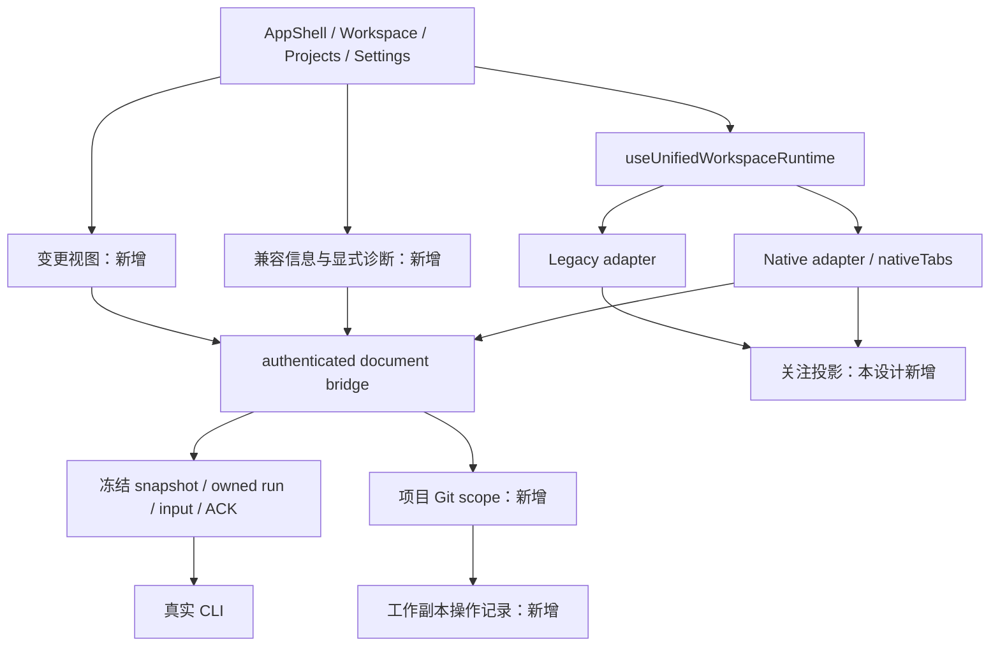
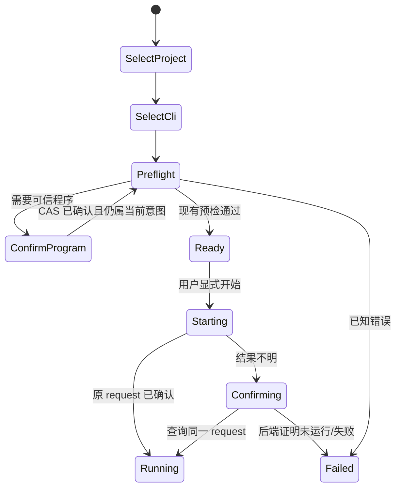

# CC Desk 工作区演进设计

日期：2026-10-23（2026-10-24 按对抗审查修订）。状态：设计提案；本文中的新增类型、命令和文件均未实现。

本设计承接 [优化规划](../project-optimization-plan-2026-10-23.md)，覆盖 W0–W8。完整设计由本文、[Git 与工作副本设计](2026-10-23-git-workspaces.md)、[交付与验收设计](2026-10-23-delivery-acceptance.md) 组成。模块可以分别交付，不要求一次性合并。

## 1. 基线、范围和决策

本轮重新核实：本地仍是 `68cc31b8808160082e4739f5f144fca76c898c3f` / `0.23.2`；GitHub main 仍是 `4500d85fd0e50db96d36c492e123dcac9b20a885` / `0.25.0`。实施应以重新确认后的 main 为起点，不能直接在旧分支按缺失功能补写。本文链接本地文件用于结构定位；受后续改动影响的状态逻辑同时核对了 [精确主线 adapter](https://github.com/shawnwu2022/cc-desk/blob/4500d85fd0e50db96d36c492e123dcac9b20a885/src/session/adapters/nativeCliAdapter.ts) 和 [nativeTabs](https://github.com/shawnwu2022/cc-desk/blob/4500d85fd0e50db96d36c492e123dcac9b20a885/src/stores/nativeTabs.ts)。

默认面向已使用至少一种真实 AI CLI 的多项目开发者。技术栈继续为 Tauri/Vue/Rust/xterm；前端没有新增运行时依赖，Git 通过用户确认的本机 Git 程序接入。以下决策由本方案提出，不冒充用户已逐项批准。

| 决策 | 采用方案 | 其他选择及取舍 |
| --- | --- | --- |
| D01 产品边界 | 加强原生 CLI 宿主、恢复、关注和变更审阅 | 新建聊天/agent runtime 会重做权限、认证、模型与输入语义，本轮不选 |
| D02 接口边界 | CLI 运行、项目 Git、Desk 工作副本三种独立 authority | 在六类 CLI 资源接口直接增加任意文件读取会扩大旧授权；通用 shell API 也不采用 |
| D03 交付方式 | 兼容证据、使用流程、Git 审阅、工作副本分阶段交付 | 一次重构外壳和运行时风险大；只有文案改动无法解决后续身份/并发问题 |
| D04 通知状态 | 复用现有数据源，新增有修订号的关注投影；不持久化事件正文 | 第二套后端事件总线会复制顺序与生命周期，暂不需要 |
| D05 持久化 | 原 CLI workspace 保持 schema 1；Git/工作副本使用独立 Desk sidecar | 修改 CLI profile 使其承担 Git 权限或任务状态会耦合两套所有权 |
| D06 Git 首版 | 不执行仓库过滤器的只读比较；接入已有 worktree，显式准备新 worktree | 自动 checkout、Git 提交/合并和物理删除后置，具体原因和替代流程见 Git 设计 |
| D07 样式 | 复用 AppShell context slot 与共享控件 | 不增加一级导航、第二个终端 tab 系统或另一套通知弹窗 |
| D08 数据采集 | 测量模式显式开启，默认本地且有界；用户研究自愿 | 不增加默认上传终端内容的遥测 |

本轮不设计远程输入、无人值守调度、Provider/API Key 写入、通用 MCP 客户端、自动安装 CLI。worktree 是工作副本隔离，不是进程或凭据沙箱。

## 2. 现有主链路与扩展点



当前 [NativeRuntime](../../src-tauri/src/cli/native_runtime.rs) 持有 `DocumentBinding`，通过 `admit_native` 验证真实 Webview/header，再解析有界 Raw body。前端 `nativeDocumentBridge()` 当前是 [tauri.ts](../../src/api/tauri.ts) 的私有入口。新增服务继续在此边界组合，不暴露可由普通 `invoke()` 或任意 owner 字段替代的通用调用函数。

新命令在对应模块 `commands.rs` 定义，由 `lib.rs` 注册；受保护 wrapper 仍在 `src/api/tauri.ts` 取得 bridge，具体 DTO 校验可分文件。新增 DTO 为 camelCase、拒绝未知字段；u64 修订号沿用十进制字符串。长任务不持有 Webview resources table 或同步 mutex 跨 `await`。

## 3. 全局不变量

1. UI 可见性、路径、session ID 或 opaque ID 都不授予后端权限；每次操作重新验证所属 document 与 backend-held scope。
2. frozen profile/run 与当前选择分离。切项目、切 profile、切页面后，旧请求的成功、错误和 finally 都不能覆盖新状态。
3. 输入 unknown/partial 不重放，launch unknown 查询原 request；UI 的“恢复”不能暗中生成第二个 run。
4. 关注“已读”只操作 GUI 的确切回执或本地展示修订，绝不批准 CLI 权限、发送按键或清除另一轮事件。
5. 只读视图不触发 CLI、Git 写入、仓库 hook/filter 或网络获取。Git 的运行策略单独定义，不能只靠按钮名称保证只读。
6. 新状态缓存、输出、文件读取和临时文件都有字节/条目/时间预算；超限返回可识别的 partial/unavailable，不伪称空。
7. 发布、平台、真实账户与纯宿主证据分层；未验证格不能转成 PASS。
8. 新侧栏和诊断不卸载终端、不改变滚动缓冲、输入 owner 或 transport ACK。

## 4. W0–W2：能力目录与兼容证据

### 4.1 两种事实分开存储

现有 [native-cli-feature-inventory.json](../testing/native-cli-feature-inventory.json) 是历史宿主能力与案例库存，包含旧源码和 `NOT_RUN`；不能直接改 status 为 PASS 当作新版本认证。

新增建议文件：

- `resources/cli-compatibility.v1.json`：唯一的当前实现能力声明，进入构建；用稳定 featureId 关联已有案例，不复制测试正文。
- `docs/testing/cli-evidence/<source-sha>/<evidence-id>.json`：经过审核的证据索引，只引用经过准入的 artifact 和摘要。目标机敏感原始材料留在受控产物库，不提交。
- `scripts/validate-cli-compatibility.mjs`：验证数据模型、唯一键、案例存在、证据身份、来源完整性；生成 README 能力表和 `docs/testing/cli-compatibility.md` 的标记区块。
- `src/generated/cliCompatibility.ts` 与后端 `include_str!` 消费同一源 JSON；先生成再 typecheck。生成文件不包含账户、机器用户名或绝对路径。

目录同时表达实现与验证，而不是一个 `supported: true`：

```ts
type CapabilityImplementation = 'implemented' | 'unsupported' | 'experimental'
type VerificationLayer = 'A' | 'B' | 'C'
type EvidenceResult = 'pass' | 'fail' | 'blocked' | 'not-run'
interface CapabilityRule {
  featureId: string
  cli: 'claude' | 'codex' | 'opencode'
  versions: string[] // 明确验证/声明的版本，不隐含接受未来版本
  platforms: Array<'windows-x64' | 'macos-arm64' | 'linux-x64'>
  implementation: CapabilityImplementation
  sourceRevision: string
  caseIds: string[]
  evidenceIds: string[]
}
```

上面的 `CapabilityRule` 是运行时 DTO。源 JSON 不写自指的当前 commit SHA；`sourceRevision` 由构建已有的精确源码元数据注入，开发脏树标为 working-tree，不生成可用于发布的 current PASS。注入沿用现有 `CC_DESK_BUILD_SHA`（release 与 D11/历史证据 workflow 已设置）；dev、普通 CI 与本地构建没有该变量，统一标为 `working-tree`，此类构建不参与 current 声明，只有绑定精确 SHA 的发布构建才可展示 current 认证。已跟踪的生成文件只含规则和内容摘要，不通过“把当前 SHA 写入文件后再提交”制造循环身份。

初始 featureId 列表固定为 `launch.new`、`launch.raw`、`resume.picker`、`resume.id`、`session.rename`、`session.unarchive`、`history.read`、`activity.observe`、`input.text`、`input.image`、`terminal.resize`。CLI 原生 capabilities 不因目录声明而新增授权。区间支持后续必须有单独迁移测试与明确上下界，首版只接受 exact versions。

证据索引必填 `evidenceId/sourceSha/platform/cliVersion/binaryDigests/caseId/layer/result/observedAt`，B 类 CI 另需 `workflowRunId/attempt/artifactDigest`，C 类另需 `targetProfileId/accountAuthorizationRef/lane/driverDigest`。这里的 target/account reference 是不可识别个人的审计 ID；未知 binary chain 不能宣称精确 binary 认证。

针对最终签名产物形成的 C 层证据是该 source/run/attempt 的外部审计产物，完成后追加到该次发布的证据索引，不重建二进制来嵌入其自身摘要。后续回存仓库的记录属于历史档案。首版应用不后台下载新索引：只展示随构建带入的历史记录和实现声明，最终版本认证由对应发布证据页说明；没有捆绑 current 证据不等于功能失败，也不能由 UI 自动升级成 PASS。

### 4.2 匹配和用户展示

匹配维度为 CLI、实际查询的 program/version、平台及动作。证据源 SHA 不等于当前构建时显示“历史验证记录”，不能推断当前源码已通过。无版本、版本不在目录、程序身份改变都显示“版本未验证”；明确不支持的操作才显示“不提供”。

目录是解释与测试选择输入，不新增一个替代现有 backend admission 的安全门。未知版本仍按现有 raw/TUI 路径的明确政策处理；新增版本相关附加能力默认不可用，不能偷偷 fallback 到另一个 executable、旧 root 或 Legacy 路径。

### 4.3 显式版本诊断

沿用现有零执行 availability 检查。新增的两个命令为：

| 命令 | 严格请求 | 响应 / 行为 |
| --- | --- | --- |
| `cli_get_compatibility_info` | `{profileId, expectedProfileRevision}` | 当前目录匹配与已有 probe 结果；不启动进程 |
| `cli_probe_program_version` | `{profileId, expectedProfileRevision, probeRequestId}` | 用户点击后才运行冻结的确切程序；返回安全版本结果或固定错误 |

执行规则：冻结 selected executable/launcher/profile 与目录修订；每 CLI 使用目录内固定、已验证的版本参数，禁止前端传 argv。每 profile 最多 1 个并发，全局 2 个；请求 4 KiB、stdout 64 KiB、stderr 16 KiB、执行上限 5 秒。stdout 只按精确格式提取长度 ≤128 的版本串，其余原始输出丢弃，不回显/记录。

helper 采用现有 owned-process 原则，超时后停止、等待真实 reap；wait 未确认时结果为 `PROBE_OUTCOME_UNKNOWN`，不能释放 owner 或同 ID 重跑。新请求的人工重试必须先确认旧 helper 已结束。缓存仅在当前应用进程有效，键包含 profile revision、program/launcher 文件身份、目录 revision；5 分钟过期，文件变化立即失效。返回的版本描述所选程序，不自动证明某个既有 running CLI 正在执行相同字节。

需要修改的边界：`cli/commands.rs`、`cli/native_runtime.rs`、新增 `cli/compatibility.rs`/`cli/version_probe.rs`、`src/api/tauri.ts`、新增 `src/api/cliCompatibility.ts`。不复用 Codex 粘贴能力探测来探测所有 CLI；原有策略保持各自语义。

### 4.4 依赖闭合

对主线 dependency review 的剩余项，每条保留 `advisoryId → lock graph → feature/platform → reachable sink → disposition → regression target`。兼容补丁单独交付；GTK/WebKit、ZIP/updater 或协议 major 迁移分别立 PR。`needs_review` 可以保留，不能通过全局忽略、强制跨 major override 或取消 required check 变绿。

本方案不预测未来版本的安全状态。每次实施先重新读取官方公告和锁文件；证据过期时重核，不把上轮 npm 结果当作本轮全生态安全认证。

## 5. W3：首次使用和恢复交互

### 5.1 首次使用主流程

继续使用 `NewSessionDialog`、`LaunchProgramDiscovery`、`newSessionDraft` 和 `cliProfiles`。增加的是连续的准备状态展示与链接，不增加第三套 profile/草稿存储。



进入指引和页面切换不启动 CLI。初始默认 CLI 遵守主线已有偏好：新安装默认 Claude，已有显式 Codex/OpenCode 选择不被覆盖。程序发现只列候选；用户确认保存后按现有 exact-revision continuation 启动，不另写 shortcut。

`SetupJourney` 为临时 UI 状态：`projectSelection + cli + profileId/revision + navigationSequence + requestSequence`。导航/选择变化使旧 continuation 失效；取消后再次打开重新读取权威状态。未完成指引不写持久化“已配置”布尔值。

### 5.2 固定恢复文案和动作表

| 原因 | 主反馈 | 可提供动作 | 禁止行为 |
| --- | --- | --- | --- |
| 程序未信任/缺失 | 确认已安装程序或查看安装说明 | 现有发现、设置、官方文档 | 自动下载安装、替换明确选定的程序 |
| profile/CAS 冲突 | 启动配置已变化，请重新核对 | 重新加载并展示当前值 | 自动套用旧表单写入 |
| launch unknown | 启动结果待确认 | 查询原 request、已授权的停止/诊断 | 将按钮实现为第二次 start |
| 输入 partial/unknown | 输入状态不确定，当前输入已暂停 | 查询/诊断、用户选择现有恢复路径 | 重新粘贴、重发历史按键 |
| 历史源 busy/partial | 本次读取受限，结果可能不完整 | 显式重新读取、来源详情 | 清空成功历史、修复/重建 CLI DB |
| 来源身份不匹配 | 无法确认原会话来源 | 返回 CLI 原生流程或更正配置 | 猜路径、默认 root、最新 profile 替换冻结来源 |
| 新附加能力不可用 | 当前版本尚未验证该能力 | 查看支持说明、版本诊断 | 隐藏原有终端或强迫升级 CLI |

错误映射集中在新增 `src/utils/recoveryGuidance.ts`，输入只允许既有安全码与已确认上下文；返回 `messageKey/actionKinds`。正常界面使用中文/英文自然文案，技术 IDs 只出现在既有安全诊断允许的详情中。

## 6. W4：统一关注入口

### 6.1 数据来源与精确确认

现有 Legacy `attention`、Native `observationNotice`、Codex program status、OpenCode observer 都继续是原始事实来源。新增 `src/stores/unifiedAttention.ts` 只派生、排序和记录本轮“已看见”状态，不接管 hook 或 PTY。

```ts
interface AttentionViewItem {
  itemId: string
  sessionId: string
  projectKey: string
  cause: 'error' | 'permission' | 'input' | 'waiting' | 'reply-notice'
  provenance: 'legacy-event' | 'native-receipt' | 'native-state'
  viewRevision: string
  receivedAt: number | null
  unread: boolean
  action: 'activate' | 'resume' | 'diagnostics'
}
interface AttentionSelection {
  itemId: string
  expectedViewRevision: string
}
```

`itemId` 和 `viewRevision` 是本地投影身份，不是 backend authority。私有映射保留 exact Native request/run/generation、原 receipt eventId，或 Legacy tab/pty/generation。Native `requestId` 不能因通知结构只有 run/generation 而省略。历史通知继续使用 adapter 持有的精确历史 claim。

每个 owner/cause 的内容变化才递增 `viewRevision`；仅重绘、标题或相对时间更新不制造新未读。Legacy 原 reducer 没有精确 eventId 的路径新增内部单调 revision，不用毫秒时间戳代替唯一身份。移除 owner 释放投影；原生产者 tombstone 保持生效。表仅保留当前 owner 和既有 adapter 持有的历史通知，最多 4,096 项；超限时展示部分结果，不确认被省略项，也不扩大生产者容量。

同一 owner 的多个来源按实际已有语义合并：有 exact receipt 的 reply-notice 使用 receipt；持续 permission/input/waiting 使用权威运行状态；错误保留独立项。同一事实不因 observer 与状态投影各到一次而产生两个确认入口。`native-state` 没有可确认的 receipt 时，仅记录本地 seen revision，不调用 `ackReplyEndNotice`。receipt 的 ack 也不能清掉另一个状态项。

确认流程：捕获 `AttentionSelection` → 重新匹配原 owner → 激活或走既有显式恢复 → 当前窗口真实聚焦且该会话已显示 → 再比较 viewRevision 与原 receipt → 确认。期间来了新事件则旧确认不生效。等待权限/等待输入是活动状态，查看只能清本地 unread，不能清除仍成立的等待状态；错误继续粘性保留。

所有确认入口，包括现有 [useUnifiedWindowAttention](../../src/composables/useUnifiedWindowAttention.ts) 的聚焦路径，经过同一新增 `confirmSeen(expected)` 适配层。Native 底层仍调用 `ackReplyEndNotice(tabId, attempt, eventId)` 或 adapter 的精确历史 clearUnread；Legacy 增加 `ackPtyIfCurrent(ptyId, generation, expectedRevision)`。同步检查和删除在同一次 store action 内完成，禁止先校验再异步清整项。

### 6.2 排序与交互

优先级固定为 error → permission → input/waiting → reply-notice；同类按首次进入当前未读状态时间升序，最后按稳定 itemId 排序。不按每次刷新时间跳动，不依靠颜色表达原因。

会话栏顶部复用现有计数增加“需要处理”按钮，打开共享 context slot 的关注列表；点击条目定位现有会话。若用户有未提交的会话改名，走既有离开/取消规则，不覆盖表单。仅打开关注列表不批量确认。

增加可配置 action `next-attention`，默认不绑定，避免抢 CLI 键位。旧五字段持久化数据必须在读取层先对缺失的 `next-attention` 补 `null` 再走 `validShortcutBindings` 校验——当前 `readShortcutBindings` 对缺键数据会整体回退默认绑定，不能让该回退吃掉旧配置；新增键默认 null。不能因少一个新字段而重置用户全部绑定。冲突、IME、输入域、模态、终端优先级沿用已有规则。

不新增 OS 通知插件；已有窗口 attention 继续由一个 owner 发出。未来平台通知如需要，另过 capabilities 与隐私设计。

## 7. UI 容器与可访问性

沿用 [DESIGN.md](../../DESIGN.md) 的颜色/token、1024×640 最小窗口、四种 GUI/终端组合和共享控件。右侧 context slot 增加 `contextMode: 'resources' | 'attention' | 'changes'`，但仍只有一个容器和一组焦点/关闭行为。窄屏使用已有 AppDrawer；不叠加多个抽屉。

`resources` 的六类数据仍要求当前会话的原授权；`changes` 使用用户选定注册项目的 Git scope，明确标注“项目工作副本”，不声称它就是 TUI 内当前 cwd；`attention` 是已持有会话数据的 UI 投影。

```text
Workspace
  项目/会话栏                 真实终端                 context slot
  [搜索] [活跃] [需要处理 N]   保持实例和滚动记录        资源 / 关注 / 变更
  项目 A                                               当前项目与读取状态
    Claude 会话                                        结构化列表 / 文本 diff
    Codex 会话                                         单一关闭入口
```

新增控件使用按钮/列表语义，不滥用 tablist 创建第二个终端 tab。焦点返回打开者；移除后 fallback 到仍存在的项目行；ARIA live 仅播报聚合数量/安全状态，不读出整个 diff 或终端正文。refresh 不抢焦点，部分数据/未知状态有可访问文本。像素与真实 WebView 验收独立记录。

## 8. W5：性能与诊断设计

测量使用独立 fixture 和显式 diagnostics mode，不采集真实输入内容。每条测量只有 `metricId/sourceSha/scenarioId/platform/renderer/workloadId/start/end/outcome/counts`；诊断导出删去路径、session IDs、argv、env、文本和凭据。默认只存内存环形缓冲 10,000 条，导出上限 2 MiB，用户手动触发。

| 测量 | 起点 / 终点 | 明确排除 |
| --- | --- | --- |
| shell ready | 应用启动时间标记 / 主导航可交互 | 模型首次响应 |
| launch preparation | 用户确认 / 冻结并提交同一 request | CLI 模型推理 |
| first PTY output | 实际 spawn / 首个有效输出帧呈现 | “已开始”UI 占位 |
| session switch | 用户选择 / 对应终端激活并完成必要 fit | 后台重建终端 |
| synthetic input echo | 固定合成 payload 提交 / 测试 echo 到达 renderer | 用户提示词内容 |
| catalog update | 受影响 owner 变化 / 对应项目投影呈现 | 其他项目全表替换 |

常规延迟每目标先预热 10 次、采样 100 次；冷首屏另做 30 次新进程启动且不预热 renderer。保留失败和超时，报告分位数、样本数、范围和硬件/负载。项目、owner 和压力数据使用现有完整 5,000/30/120 库存；原始压力测试不缩减。另测 1/10/30 个真实合成 PTY；真实账户模型场景单独按授权预算验收。

只在重复测量表明收益后实施：保持数组 identity 的局部投影、列表可见区域渲染、批量调度等。不得减少输出 ACK、吞掉状态变化或重建终端取巧。首轮可交付测量报告而不改性能代码，这属于正确退出结果。

CI 的 source/run/attempt、四 harness/16 片、忽略集合和原始计数不变。新增可选校准必须继续显式准入；报告资源成本，不承诺固定十分钟。阈值与完整测试矩阵见交付文档。

## 9. 数据迁移与故障隔离

- W0–W3 不迁移 CLI 用户数据；manifest 是构建资源，版本 probe 缓存不落盘。
- W4 的已读状态不增加持久化；快捷键新增可选 key 由原串行 writer 保存，兼容未知字段，旧配置不会整体重置。
- contextMode 是当前窗口 UI 状态；刷新/降级后回 resources，不持有旧 Git scope。
- Git/工作副本 sidecar 详见独立设计；旧版本忽略它，不迁移旧项目路径，不自动打开/恢复新会话。
- 模块读取失败关闭对应增强能力，主导航、已运行终端、其他 CLI 和原资源范围继续独立。例外是 Git 工作副本依赖集合不可读时，项目注销与新副本计划需全局阻止以保留恢复入口；普通注册/隐藏/运行仍可用，具体安全码与解除条件见 Git 设计 6.4。

## 10. W8：文档与反馈

交付一个已安装/已认证 CLI 的 3 分钟上手路径、一个多会话关注演示、一个源身份失败的恢复示例。演示只用隔离 fixture，不显示真实 token、路径或聊天记录。README 先说明下载、适用人群、工作方式和边界，再链接工程证据。

用户验证拆为两批：M1 的 D01a 让 5 名目标用户完成“启动、定位待办、恢复”；G03 完成后的 M2/D01b 再让 5 名目标用户完成“查看改动并解释限制”，可邀请同一批人回访。记录耗时、是否求助、失败阶段和用户自己的表述。没有自动上传，也不从竞品星数推导付费需求。第二批结果用于决定是否进入 W7；自动 checkout、更多产物预览或远程只读观察另立设计。

## 11. 已确定与需外部资源的事项

实现者可以自行选择内部纯函数拆分和测试 fixture 的具体文件名；不能自行改变上述 authority、确认语义、预算、持久化职责或 worktree 首版范围。协议调整须同时改本设计、调用方和行为测试。

没有必须向用户追问才能完成设计的产品问题。真正运行 C 层、安装包交互和额外校准时，仍需明确测试账户、隔离目标、模型/CI 预算和执行窗口。缺这些资源只阻塞对应验收格，不授权读取用户真实会话或修改宿主 ACL/Job 限制。
