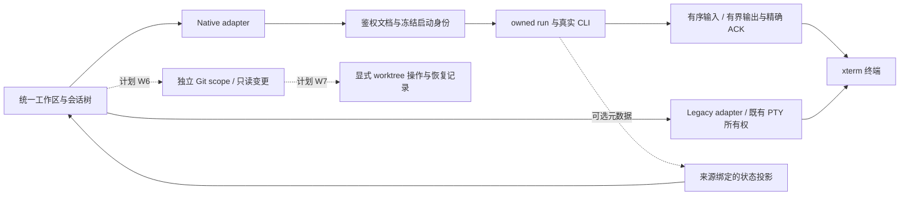

# CC Desk 优化完善规划（2026-10-23）

状态：研究与规划建议，尚未进入功能实施。后续细化已形成 [完整设计入口](design/2026-10-23-workspace-evolution.md)、[Git/worktree 设计](design/2026-10-23-git-workspaces.md) 与 [交付验收](design/2026-10-23-delivery-acceptance.md)；本轮只改文档。2026-10-24 按对抗审查裁决修订：统一性能阈值口径、补充 G01 方案对照与降级阶梯、修正本地基线表述。

## 1. 建议方向与分析口径

建议把 CC Desk 定位进一步收敛为：**可信、可恢复、适合并行开发的原生 AI CLI 工作台**。优先完成真实环境验证与兼容性管理，再改善从首次启动、关注待办到查看代码变更的使用过程，最后引入受控的 Git worktree 工作流。

现有 authenticated document、冻结 launch snapshot、owned run、输入不重放、有界输出和精确 ACK 值得保留。新增价值应主要落在跨会话管理、可解释的恢复、工作区隔离和结果审阅；模型、认证、权限决策、slash 命令仍交给真实 CLI。参见 [产品约束](project-contracts.md)、[Native CLI 架构](native-cli-v3.md)。

本规划按“综合完善”展开。受众假设为已经使用至少一种 AI CLI、经常并行处理多个项目的开发者；没有用户访谈或留存数据证明更广泛的市场需求。后续需求验证应直接检验这些假设。

### 两个必须区分的源码基线

| 对象 | 本次核实结果 | 使用方式 |
| --- | --- | --- |
| 本地工作区 | `fix/opencode-backend`，`68cc31b8808160082e4739f5f144fca76c898c3f`，`package.json` 为 `0.23.2`；开始时工作区干净 | 用于源码链路检查和本次本地测试 |
| GitHub 当前主线 | `4500d85fd0e50db96d36c492e123dcac9b20a885`，已发布 `v0.25.0`，发布时间 UTC 2026-10-22 23:11:59 | 用于判断哪些工作已经交付、哪些仍需规划 |
| 两者差异 | GitHub compare 返回主线领先 77 个提交、涉及 252 个文件，本地 HEAD 是比较的共同祖先；实测 `origin/main..HEAD` 为 0，本地分支没有主线缺失的独有提交 | 实施时必须重新确认精确基线；届时可直接快进到 main，无保留成本，但本文档等未跟踪产物需先行带走 |

来源：[源码比较](https://github.com/shawnwu2022/cc-desk/compare/68cc31b8808160082e4739f5f144fca76c898c3f...4500d85fd0e50db96d36c492e123dcac9b20a885)、[v0.25.0 发布](https://github.com/shawnwu2022/cc-desk/releases/tag/v0.25.0)。下文的本地链接用于定位结构，最新功能状态同时核对了精确主线文件与发布记录。

## 2. 当前项目判断

### 已有基础，以及真正需要补齐的部分

| 领域 | 已核实的能力 | 下一步判断 |
| --- | --- | --- |
| 产品外壳 | Workspace / Projects / Settings；统一会话树、搜索、恢复、归档、启动配置、终端偏好 | 继续复用单一外壳，避免另建第二套聊天产品 |
| 原生运行 | Native / Legacy adapter 隔离；精确请求和运行身份；不确定输入不重放；有界输出 | 主要任务是证明真实目标行为和控制兼容漂移，不能以重写运行时替代验收 |
| 三种 CLI | Claude、Codex、OpenCode 接入；主线已有 OpenCode 新建、恢复、改名和活动观察，Codex 原生状态信号 | 建立按版本、平台、能力细分的支持声明；不能把品牌级“支持”理解为所有版本和能力都支持 |
| 交互 | 已有程序发现与确认启动、快速切换、状态图标、关注队列、窗口提示和安全诊断 | 改进流程连贯性与可发现性，先观察用户卡点，避免把现有功能重新做一遍 |
| 数据 | workspace/profile CAS、原子写入、只读资源范围和历史来源身份 | 扩展能力前先维护身份和并发契约；升级/回退要区分 Desk 数据、CLI 数据与项目文件 |
| 工程 | 分组 Vitest、独立 Node policy、Rust 原始库存、视觉/生产 CSP/发布签名门禁 | 测试结构较完整；仍存在真实 CLI、安装包和特定 Windows 宿主的证据缺口 |
| 开发工作流 | 已检查的产品链路以项目、会话、终端和 CLI 资源为中心，未发现集成的 Git diff/worktree 管理界面 | Git 只读审阅与可选隔离工作区值得做小规模验证，属于新增产品能力 |
| 项目传播 | GitHub API 的 About 描述仍只写 Claude Code；README 主要围绕架构与验证说明 | 改进下载、快速上手、实际演示与版本能力说明；关注度不是需求或质量证明 |

主要源码定位：

- [统一运行协调器](../src/composables/useUnifiedWorkspaceRuntime.ts)、[Native adapter](../src/session/adapters/nativeCliAdapter.ts)、[会话身份](../src/stores/nativeTabs.ts)。
- [冻结启动快照](../src-tauri/src/cli/snapshot.rs)、[输入写入](../src-tauri/src/terminal_input.rs)、[输出 ACK](../src-tauri/src/terminal_transport.rs)。
- [启动程序发现](../src/components/sessions/LaunchProgramDiscovery.vue)、[会话树与搜索](../src/components/sessions/SessionsPanel.vue)、[统一窗口关注](../src/composables/useUnifiedWindowAttention.ts)、[安全诊断](../src/components/settings/sections/AboutSection.vue)。
- 主线的 [Native 架构](https://github.com/shawnwu2022/cc-desk/blob/4500d85fd0e50db96d36c492e123dcac9b20a885/docs/native-cli-v3.md)、[状态语义](https://github.com/shawnwu2022/cc-desk/blob/4500d85fd0e50db96d36c492e123dcac9b20a885/docs/session-status-semantics.md)、[会话 adapter](https://github.com/shawnwu2022/cc-desk/blob/4500d85fd0e50db96d36c492e123dcac9b20a885/src/session/adapters/nativeCliAdapter.ts)。

核心链路及建议扩展位置：

图中鉴权 Native 链路是新功能入口；Legacy 继续通过自身兼容 adapter 持有原有生命周期，不因共用外壳而获得 Native 授权。

### 已交付事项，不重复列为新增任务

主线已经包含活跃会话筛选、默认仅启用 Claude 且保留用户显式偏好、OpenCode 原生元数据改名与活动观察、Codex 状态/身份相关修正、焦点优先的 Ctrl+B / Cmd+B，以及 Vue、Vite、Vitest、Tauri/TLS 的一轮升级。本地旧分支没有全部包含这些变更。

来源：[主线路线图](https://github.com/shawnwu2022/cc-desk/blob/4500d85fd0e50db96d36c492e123dcac9b20a885/docs/roadmap.md)、[依赖核查](https://github.com/shawnwu2022/cc-desk/blob/4500d85fd0e50db96d36c492e123dcac9b20a885/docs/dependency-review.md)、[v0.25.0 发布](https://github.com/shawnwu2022/cc-desk/releases/tag/v0.25.0)。

### 已证实的证据缺口与文档漂移

1. **真实目标验收未闭合。** v0.25.0 发布说明仍披露 D20 Layer-C、原始 nativeAll、安装版 Windows WebView 未认证；18 项 Job-free 和 4 项 elevated-host 相关测试未验证。这些是证据缺口，不等同于已证实的 22 个产品故障。OpenCode 的真实登录/模型行为另有矩阵，不能借用双 CLI D20。
2. **支持说明发生漂移。** 精确主线 README 仍说 OpenCode 改名不支持，而主线架构与 adapter 已提供官方 HTTP 元数据改名；主线路线图顶端仍停在 v0.24.0，并保留“下一版仅本地”的表述，而 v0.25.0 已发布。应同步状态和能力来源，保留历史证据的历史属性。
3. **依赖维护尚有尾项。** 最新核查仍列出 Linux glib、特定 quick-xml 构建路径、Windows updater ZIP 等待进一步处置的输入；应按实际可达路径和上游兼容升级处理，不能直接宣称全部可利用，也不能以 npm audit 零匹配代替整机安全验收。
4. **缺少本次真实 WebView 性能数据和用户研究。** 本次没有测量当前安装包的启动、输入延迟、内存或用户成功率，不能据文件大小直接判定性能故障。

来源：[发布说明](https://github.com/shawnwu2022/cc-desk/releases/tag/v0.25.0)、[精确主线 README](https://github.com/shawnwu2022/cc-desk/blob/4500d85fd0e50db96d36c492e123dcac9b20a885/README_CN.md)、[下一版验证记录](https://github.com/shawnwu2022/cc-desk/blob/4500d85fd0e50db96d36c492e123dcac9b20a885/docs/next-version-validation.md)、[依赖核查](https://github.com/shawnwu2022/cc-desk/blob/4500d85fd0e50db96d36c492e123dcac9b20a885/docs/dependency-review.md)。验证记录中的旧候选失败或等待状态不能直接覆盖后来的同源发布结论。

## 3. GitHub 对比：借鉴机制与取舍

详细仓库、星标快照、活跃状态、许可证与一手来源见 [外部调研](research/2026-10-23-ai-workspace-benchmark.md)。星标用于选择观察样本，不用作质量排名或功能需求投票。

| 参照项目 | 对 CC Desk 有价值的机制 | 建议取舍 |
| --- | --- | --- |
| [Emdash](https://github.com/generalaction/emdash) | 并行 agent 与独立 worktree、变更审阅的连接 | 先做本地只读变更视图，再验证 worktree；不先建全套 IDE |
| [cmux](https://github.com/manaflow-ai/cmux) | 终端优先、未读提示与快速定位需要处理的会话 | 扩展现有关注体系，保证事件有来源、未读与当前活动分离；其 macOS 实现不等于 Windows 可直接移植 |
| [CloudCLI / Claude Code UI](https://github.com/siteboon/claudecodeui) | 将项目文件、Git 和运行会话放到相邻工作流 | 借鉴结果审阅和导航；代码复用另做许可证审查 |
| [Happy](https://github.com/slopus/happy) | 跨设备继续工作、通知与控制权交接 | 作为远期需求验证；远程访问将新增设备认证、密钥、重连与控制权问题 |
| [AionUi](https://github.com/iOfficeAI/AionUi) | 面向用户的能力发现与较完整的入口展示 | 借鉴上手指引与状态可解释性，保留 Desk 的 CLI 原生定位 |
| [CC Switch](https://github.com/farion1231/cc-switch) | 独立解决配置切换问题 | 建立清晰的配合说明，继续让配置修改留在 CLI/专用工具 |
| [Codex](https://github.com/openai/codex)、[OpenCode](https://github.com/anomalyco/opencode) | 官方协议、状态事件、元数据接口与版本演进 | 优先消费稳定公开接口；每项能力带具体版本、来源及证据层级 |
| [Vibe Kanban](https://github.com/BloopAI/vibe-kanban) | 任务、worktree、审阅的组织方式 | 原公司已宣布关闭，项目继续开源、由社区维护；借鉴机制和服务依赖教训，不假定原团队持续运营 |

从样本得出的产品推断：**最贴合 CC Desk 的扩展，是“看见需要处理的会话 → 回到真实 CLI → 看见代码变化 → 保留可恢复的工作区”。** 这只是方向假设，需用真实用户任务验证，不能由竞品功能数量直接推导投入价值。

## 4. 优先级与工作包

P0 表示应先闭合的质量/兼容性工作；P1 表示改善现有核心流程；P2 表示需要新增契约与用户验证的扩展。人日是粗估实施量，不包含等待测试账户、目标机或上游修复的时间。

| 编号 | 优先级 | 工作包 | 估算 | 主要依赖 | 退出条件 |
| --- | --- | --- | --- | --- | --- |
| W0 | P0 | 对齐当前状态、能力说明和下一轮实施基线 | 3–4 人日 | 当前发布记录、源码差异 | README/roadmap/能力声明一致；已交付与缺口分开记录 |
| W1 | P0 | 三 CLI 版本兼容矩阵与真实目标验收 | 8–12 人日 | W0、授权账户/目标机 | 每格绑定源码、平台、CLI binary/version/hash、结果和证据；未完成格明确保留 |
| W2 | P0 | 剩余依赖输入与升级回归闭合 | 4–7 人日 | W0、Linux/Windows 测试目标 | 每项有修补、可达性判断或明确保留理由；权限面与原测试库存不扩大/缩减 |
| W3 | P1 | 首次使用、能力说明和故障恢复流程 | 4–6 人日 | W0，复用现有发现与诊断 | 用户可完成首次启动并理解典型失败的下一步；无隐式启动或配置改写 |
| W4 | P1 | 跨项目关注入口与快捷导航 | 6–8 人日 | W1 的状态语义、既有会话投影 | 能迅速定位需要动作的会话；精确确认不清新事件、不把未知解释为完成 |
| W5 | P1 | 真实应用性能基线与测量驱动优化 | 5–8 人日 | W0、目标 WebView、固定工作负载 | 得到可复现基线；只采用收益得到验证且无语义回归的改动 |
| W6 | P2 | 注册项目范围内的 Git 只读审阅 | 12–18 人日 | W1/W3、独立 Git scope 技术验证 | 可检查 tracked 文件的原始内容差异；处理预算、并发与不可信配置；技术验证 No-Go 则停止扩展 |
| W7 | P2 | 可选 worktree 工作区 | 10–16 人日 | W6、身份/并发/持久恢复设计审查 | 接入已有或显式准备新副本；手动初始化后登记；不自动 checkout 或物理删除 |
| W8 | P1，贯穿 | 快速入门、演示、反馈入口与需求验证 | 3–5 人日＋持续小额投入 | W0/W3 | 使用说明与实际版本一致；收集可归因的失败案例与需求，而非只追星标 |

细化后总量约 55–84 工程人日，替代初版 43–66 人日粗估。按 1 名主要维护者、可预约的独立评审和目标机资源，考虑约 13–20 周滚动容量；等待账户/目标、未知平台机制和上游 major 迁移另计。W0–W5＋W8 可独立交付，约 33–50 人日。详见 [更新估算与变更单](design/2026-10-23-delivery-acceptance.md)。

### W0：把状态和能力说明变成可靠入口

- 新规划落在当前主线重新确认后的基线；旧分支与用户测试目录保留原状。
- 能力清单至少按 `CLI × 版本范围 × 平台 × 操作` 记录来源和证据。区分“支持”“版本未验证”“上游不提供”“暂不可观察”。利用已有 [特性库存](testing/native-cli-feature-inventory.json)，先判断能否扩展，避免新建重复权威。
- 更新 README 的 OpenCode 能力、roadmap 当前发布状态和 GitHub About 文案建议；旧 execution 记录保留为历史。
- 发布说明引用精确证据，不让某项历史 PASS 自动适用于新 SHA。文档一致性优先通过维护单一来源解决，不为文字堆叠镜像测试。

### W1/W2：先降低兼容性和真实环境风险

- 三层证据分别列出：A 单元/契约，B 宿主/操作系统，C 已授权真实 CLI。D20 保持 Claude/Codex 的 Desk/系统终端 × observer off/on 四格；OpenCode 单独设计真实新建、恢复、停止、重启继续的覆盖。
- 对当前已支持版本及新上游版本分别验证启动、恢复、原生元数据操作、状态信号和历史来源；OpenCode 版本演进尤其要核对 server/API/DB 存储契约，不把开发分支说明当作全部稳定版本的行为。
- 本次 GitHub `releases/latest` 核实 OpenCode 稳定版为 [v1.19.4](https://github.com/anomalyco/opencode/releases/tag/v1.19.4)，而开发分支 README 已出现 `@opencode/cli` 与 v2 指引；先验证稳定版，再对开发线单独实验。不得据此声称 v2 已是稳定发布或已兼容。
- 现有 availability 是不执行 CLI 的预检；版本/能力诊断如需运行进程，应是用户显式动作或隔离测试，使用受控子进程、超时和安全 DTO，不能悄悄改变启动预检语义。
- 安装包验证覆盖 Windows WebView2、100%/125%/150% DPI、CJK/emoji/IME、完整粘贴、多会话、异常退出与恢复；macOS/Linux 按原功能和渲染范围执行。原始 nativeAll 需要符合项目准入的真实宿主。
- 依赖剩余项按当前官方公告和调用链复核；优先兼容补丁、成组 GTK/WebKit 或 updater plugin 迁移。保留 `-D warnings`、ACL 显式限制、完整名称/忽略集合和发布来源绑定。
- 需要账户、安装/隔离目标、模型调用预算或额外 CI 配额的实际动作，在工作包实施时形成具体方案再确认；本规划没有开展这些动作。

### W3：首次使用与恢复，优先整合既有能力

- 使用现有程序发现、启动配置、项目注册、只读诊断和共享控件，形成“选择已安装 CLI → 选择项目 → 确认可信程序 → 开始”的连续指引。已完成安装/登录的用户不应被重复配置表单阻断。
- 为缺失程序、配置修订冲突、历史源忙/截断、恢复身份不明等已有安全码给出简短下一步；高级诊断放在详情，正常流程不显示 requestId/runId 等实现细节。
- 明确区分“启动结果待确认”与“启动失败”。恢复查询同一 request，不能把重试按钮变成自动再启动。
- 首轮安排 5 名目标用户完成固定任务，记录阻塞点和时间；这用于可用性迭代，不视为统计上的市场验证。

### W4：将现有注意力机制变得容易使用

- 复用 `UnifiedSession`、现有计数、未读事件、快速切换与窗口提示；提供聚合的“需要处理”入口和跳到下一条的操作，先验证比现有列表更易用。
- 状态来源不同必须如实表达：进程运行、CLI busy、等待用户、历史回复结束和未知并非同一状态。只消费所属 run 的认证事件/正式协议；无来源时展示未知。
- 保留未读回执与当前活动的独立性；迟到事件、重启代次、关闭后历史行、项目切换不串扰。聚焦不应误清其他会话事件，状态刷新也不应自行抢焦点。
- 桌面通知如新增平台能力，应有用户偏好和能力审查，默认只含最少元数据；远程推送另立工作包。

### W5：性能优化必须从当前目标测量开始

仓库 [2026-10-17 性能记录](ci-performance.md#runtime-performance-audit-and-falsified-candidates-2026-10-17-local) 已否定三类未经收益证明的优化，并记载当时压力样本中投影/渲染占比较高。该历史测量用于选择测量点，不能当作当前 WebView 结论；本次不重提被测量否定的 i18n 拆分、无收益输出批处理或解析缓存方案。

- 基线分开测量应用 shell ready、启动准备、首个 PTY 输出、切换可交互、输入到显示、历史扫描、RSS/输出预算；不把模型响应时间算成 GUI 性能。
- 保留原 5,000 会话、30 owner、120 次变化压力库存；另测安装包中 1/10/30 个真实 PTY 的固定合成负载。真实付费模型回合单独管理。
- 若当前测量仍证实列表渲染主导，才评估按项目增量投影、列表可见区域渲染或降低重复计算；必须保留焦点/ARIA、搜索、行 identity、迟到结果拒绝和 listener 释放契约。
- 不以销毁隐藏终端或停止真实 CLI 换取内存数字；视图资源与进程所有权分开设计。只缓存经鉴权、可失效的只读元数据。
- 当前主线 [CI 39868059232/1](https://github.com/shawnwu2022/cc-desk/actions/runs/39868059232) 的 API 状态为 23 jobs 成功，`created_at` 到 `updated_at` 约 1,111 秒；较长 job 为 roundtrip release exclusion 768 秒、Rust 编译 bundle 562 秒、debug roundtrip 560 秒、shard 6 为 512 秒。时间含调度/协调影响，job 不能相加当关键路径，也不是纯测试耗时。
- CI 校准沿用现有显式 opt-in、精确原始测试名称和原库存。先补齐可信时序，再做同源、同 runner/cache 条件的 control/candidate 比较，同时报告耗时与 runner-minutes；没有证据就不调整分片或承诺十分钟。

### W6：先做 Git 只读审阅

范围限定为用户选择的已注册项目的 HEAD、tracked 变更列表和按需原始内容 diff；不声称所选项目等于 TUI 内当前 cwd。第一版不增加内置代码编辑器、自动提交、合并或 PR 发布。

需新增独立的后端 Git scope/DTO，而不是向通用资源接口传入任意路径或 shell 命令。先核对 `commands.rs → lib.rs → API wrapper` 和 capabilities，复用现有 document/project 身份校验。实际文件范围以实现前设计为准，候选位置为后端独立 Git 模块、前端 typed API 和现有工作区抽屉。

Git 调用使用参数数组、受控环境和输出/时间预算。细化方案采用 raw plumbing 与已捕获文件的私有目录 diff，同时处理 filter、fsmonitor、hook、网络和路径重定向；只禁 external diff/textconv 不充分。未跟踪文件首版不扫描，二进制只显示元数据；详见 [Git 执行策略](design/2026-10-23-git-workspaces.md)。

G01 须并列比较三条实现路线并按证据选择，不预设 raw 引擎最优：(a) 外部 Git raw plumbing + 私有目录 diff；(b) Git 仅做枚举与 blob 输出（`cat-file --batch`），文本 diff 由纯内存 diff 库（如 `similar`/`imara-diff`，MIT/Apache）在 Rust 内完成——该路线消除临时文件、diff 子进程与 diff 程序策略三个攻击面，且与 raw-bytes 语义一致；(c) 缩小到 staged/commit 比较、关闭工作文件读取。同时预设 No-Go 降级阶梯：工作文件读取边界不可证明时，先交付 tracked 列表 + HEAD↔index blob diff；blob 读取不可证明时仅交付元数据状态列表；全部不可证明则该平台 Git 功能关闭，保留手动注册。

验收包括非 Git 项目、无提交仓库、空格/CJK 路径、同仓库多 worktree、文件删除/改名、大 diff 截断、恶意配置和读取期间 HEAD/index 变化。base/index 冻结、工作文件按有界时间窗口捕获；标明 stale/partial，不宣称全仓库瞬时一致快照。

### W7：worktree 是工作副本隔离，不是安全沙箱

先支持识别、登记和选择用户已有的 worktree，再提供显式创建新分支/工作副本的操作。一个工作区可以关联多个 CLI 会话，不必强制每个终端创建一个 worktree。

Git 官方说明 linked worktrees 共享部分 refs 与默认 repository config；它们没有隔离凭据、网络、进程或整个文件系统。因此界面应表述“独立工作副本”，不能承诺 agent 安全沙箱。参见 [git-worktree](https://git-scm.com/docs/git-worktree)。

实现前明确：仓库/工作副本身份、基准提交、工作区 revision、关联运行、创建操作 ID、外部变动后的 reconciliation，以及创建失败的残留处理。Git 写入和 Desk CAS 无法组成一个原子事务，需要可恢复的阶段记录、仓库级并发协调和不确定结果查询。

普通 worktree 创建涉及 checkout/hook/filter 行为。细化后的首版只提供 `--no-checkout --lock` 准备，用户自行初始化后显式检查和登记；禁止自动执行仓库初始化。首版不做物理删除/清理、merge/rebase；解除 Desk 关联保留原项目、文件、分支与 Git 锁。

验收包含双工作区并行编辑与恢复、分支冲突、外部删除/移动、创建中断、应用崩溃、路径替换、重复确认和登记 receipt 丢失。证明 worktree 身份绑定到正确项目和 CLI source，不能仅依赖字符串路径。物理删除协议留待独立设计。

## 5. 更新后的滚动节奏与停止条件

| 时间窗口 | 主要交付 | 阶段判断 |
| --- | --- | --- |
| 第 1–2 周 | W0；W1 的版本/目标清单与最小真实场景；W2 依赖处置；快速上手草案 | 现状说明一致、目标可用、每个阻塞有具体缺项；没有账户/目标时不伪称认证完成 |
| 第 3–4 周 | 继续 W1/W2；W3 上手和恢复；W5 性能基线；首轮用户任务观察 | 对支持版本能说明成功/失败与下一步；数据足以决定实际性能改动 |
| 第 5–10 周 | W4 关注入口；W5 经测量确认的优化；W6 的 G01 技术验证 | 先完成现有使用闭环；Git 目标验证 No-Go 时停止扩展 |
| 后续约第 11–20 周 | 通过 G01 后推进 W6；再按用户验证决定 W7；跨平台/升级收口 | 仅为容量窗口，不承诺日期；具体依赖按完整设计的 M2/M3 里程碑 |

依赖关系：`W0 → W1/W2/W3/W5`；`W1 + W3 → W4/W6`；`W6 + 设计审查 → W7`；W8 贯穿。外部目标暂不可用时可推进独立的文档、用户研究和只读界面设计，不能越过同一功能的验收要求。

建议前 30 天精力主要投入 W0–W3 和 W5 基线。若只能选择一项差异化扩展，优先验证 **Git 只读审阅**：它与现有真实 CLI 运行模型相容，范围比远程控制或自主编排更可控，并为 worktree 奠定基础。

## 6. 衡量方式与验收门槛

以下是建议目标，不是当前实测结果；W0/W5 建立基线后再冻结阈值。指标默认通过本地实验或自愿可用性测试收集，不上传提示词、终端输出、路径或凭据。

| 指标 | 定义与建议门槛 |
| --- | --- |
| 首次成功启动 | 前提是 CLI 已安装且已认证；从首次打开 Desk 到受控运行并看到 CLI 界面。首轮目标：5 名目标用户至少 4 名无需帮助、3 分钟内完成；这是小样本验收，不是总体成功率 |
| 恢复正确性 | 故障注入矩阵中不重复执行未知输入、不重放未知创建、不串 run/source；每个已支持恢复动作都有失败边界证据 |
| 关注事件效率 | 在固定多会话任务中定位需要操作的会话，比较现有界面与候选；建议中位完成时间降低至少 30%，同时零跨会话误确认 |
| 交互性能 | 口径以 [交付验收](design/2026-10-23-delivery-acceptance.md#6-性能与可用性验收) 为准：每目标预热 10 次、采样 100 次；建议 session switch p95 ≤ 100ms、本地键盘 echo p95 ≤ 50ms。属于初始目标，需先确认测量开销和 WebView 基线 |
| 性能改动采纳 | 目标瓶颈有重复可见的改善；不得破坏输入/ACK、焦点/ARIA 和资源释放。有限样本同时给范围，不能把单次样本当 p95 |
| 长时资源 | 固定创建/关闭循环、输出压力后，owned handles/listeners/budgets 回到期望范围；内存不呈持续增长。具体预算在目标机基线后定义 |
| CI 收益 | 保留 4 harness、16 片及原门禁；先至少 3 对受控样本验证方向，再积累足够运行数讨论 p95；同时观察关键路径与 runner 成本 |
| 文档可靠性 | 每次发布核对 README 能力、roadmap、版本说明、CLI 兼容矩阵与实际源 SHA；历史状态不覆盖当前事实 |

## 7. 暂不纳入本轮的方向

- Provider/API Key 管理、独立 MCP 客户端、聊天消息重绘、通用 prompt 平台：与当前边界重叠或冲突，继续交给 CLI/专用工具。
- 通用 agent 插件市场和大规模新增 CLI：先证明三个现有适配器的真实兼容性，避免扩大未经验证的支持面。
- 自动多 agent 调度、无人确认的 merge/commit：会新增资源预算、授权、任务完成判定和并发写入问题，当前没有足够需求证据支持投入。
- 手机/远程控制：先通过访谈确认需要“通知”“只读查看”还是“输入控制”；涉及设备授权、密钥、撤销、唯一输入 owner、断线重放和后台进程语义，需单独架构与安全设计。
- 通用产物预览：W6 后若用户确有需求，先考虑有界的 Markdown/图片/文本只读预览；本轮不增加任意 HTML 执行、内嵌浏览器或自动端口转发。
- 全面重写协调器、替换状态管理或为了包体积重构：只有测量或重复缺陷证明需要时才局部调整。

## 8. 本次实际验证与后续决策

本次执行于本地 `68cc31b` / `0.23.2`，Node `v24.18.0`、npm `11.14.1`：

| 命令 / 检查 | 本次结果 |
| --- | --- |
| `git status --short`、`git rev-parse HEAD`、`git log`、定向 `rg` 和源码阅读 | 确认基线、关键链路与起始干净工作区 |
| GitHub API：main、compare、latest release、精确 CI run/jobs | 核实 v0.25.0 发布、77 提交差异、CI 23 jobs 成功；本次未重新下载和校验发布产物签名 |
| `npm run typecheck` | 通过，exit 0 |
| `npm test -- tests/productBoundary.test.ts tests/components/newSessionFlow.test.ts tests/components/launchProgramDiscovery.test.ts tests/stores/catalogProjectionIdentity.test.ts` | 4 文件、39 项通过，exit 0；Vitest 报告 6.67 秒 |
| 文档差异与引用检查 | `git diff --check` 通过；两份新增文档单独检查 84 处链接的相对目标存在性或 URL 格式、引用定义、代码围栏与尾部空白，全部通过；未声称所有外部链接均已逐一联网验证 |

npm 报告既有 `auth`/`python` 用户配置警告，Vite 报告 CJS Node API 弃用提示；本次没有改用户配置。本地测试不能证明远端 0.25.0 的运行行为。纯文档交付没有新增代码 lint 范围；未运行完整 Vitest、Rust、构建、真实 CLI、安装包、视觉或性能验收，也未触发远程 workflow。

继续细化设计已采用“先现有闭环、后 Git/worktree”的顺序，无需为设计再确认架构。实际实施前仍需确定的外部资源：

1. 可投入的工程/评审时间，及 Windows/macOS/Linux 目标资源。
2. W1 的隔离目标、测试账户、模型调用/CI 预算；按具体执行方案确定，凭据不进入聊天或仓库。
3. W6 技术与用户验证通过后，再决定是否投入 W7；远程控制与自主编排保持独立立项。

当前可进入排期的结论：W0–W5 有明确依据；W6 先做有退出条件的技术验证；W7 依赖 W6、用户反馈与持久恢复契约，不能直接按竞品功能清单开工。具体接口、状态、改动文件和验收任务以 [完整设计](design/2026-10-23-workspace-evolution.md) 为准。
